# How Efficient Is the Human Vascular System?

A physics-based study: we evolve vascular networks inside a 3D model of the
human body to optimize a trade-off between **nutrient delivery by diffusion**
(coverage + speed) and **cost** (vessel material + pumping energy), and then
compare the evolved optima against the structure of the real human arterial
tree — fractal dimension, scaling-law exponents, branching statistics,
structural motifs, size, total length, and more.

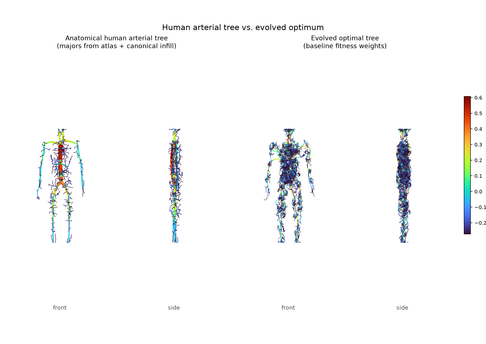

## The model

| Component | Implementation |
|---|---|
| **Body** | Voxelized 3D human (1.75 m, 63 L of tissue, 2 cm voxels) assembled from capsules/ellipsoids: head, neck, torso, arms, legs (`vascular_evolution/body.py`). A metabolic demand field places measured organ shares of resting VO₂ (brain 20%, heart 10%, liver+gut 27%, kidneys 7%, remainder uniform). |
| **Vascular trees** | Flat-array branching trees rooted at the heart. Radii follow a Murray-type rule r_p^γ = Σ r_c^γ applied bottom-up from a terminal radius; blood flows are assigned by demand-weighted Voronoi territories of the terminals and accumulated to the root (`tree.py`). |
| **Growth (genotype → phenotype)** | Trees are grown by a parameterized *space-colonization* program — the analogue of VEGF-guided angiogenesis. The 9-gene genome controls attractor density, attraction/kill radii, step size, directional momentum, noise, vertical tropism, the Murray exponent γ, and the terminal radius (`growth.py`). |
| **Diffusion physics** | Steady-state reaction–diffusion `D∇²C − M = 0` solved as a sparse linear system on ~7,900 tissue voxels, with C = 1 at terminal-tip voxels (perfusion sources) and zero-flux body boundary; concentrations are clamped at 0 where consumption extinguishes them (`physics.py`). The consumption/diffusivity ratio is calibrated analytically so a single source penetrates to the hypoxia threshold at exactly the perfusion depth δ = 3.5 cm in spherical geometry — the mesoscale reach of the microcirculatory bed each terminal artery feeds. |
| **Evolutionary algorithm** | Real-coded GA (tournament selection, BLX crossover, Gaussian mutation, elitism) with parallel fitness evaluation; ~2,000 diffusion solves per run (`evolve.py`). |

### Fitness function

```
F = coverage − 0.25·T_norm − 0.10·(V/V_ref) − 0.10·(P/P_ref)
```

* **coverage** — fraction of tissue above the hypoxia threshold (C ≥ 0.1·C₀,
  the Krogh venous-end criterion) in the solved diffusion field;
* **T_norm** — delivery speed: mean diffusion time to the nearest source,
  d²/2D, normalized by the time to cross one perfusion depth;
* **V/V_ref** — structural cost: total luminal volume over the blood volume
  held in real human arteries (V_ref = 0.5 L);
* **P/P_ref** — energetic cost: Poiseuille dissipation Σ 8μLQ²/πr⁴ at
  cardiac-output flows (5 L/min, blood viscosity 3.5 mPa·s), normalized by
  the hydraulic power the heart spends in the artery-level tree
  (P_ref ≈ 0.26 W, i.e. ~25% of total cardiac power).

The weights are physiologically anchored: a design with human-scale costs
pays ~0.2 of fitness for them, so costs matter but cannot dominate
delivery — mirroring a circulation that consumes only a few percent of basal
metabolism. All constants with sources are in `constants.py`, and the
**sensitivity analysis** below perturbs every weight 4–16× around baseline.

### The anatomical reference

The comparison target (`reference.py`) is built in two layers: 38 named
major arteries (aorta → carotids/subclavians/brachials/radials, celiac,
mesenteric, renals, iliacs → femorals → tibials) hand-placed from atlas
geometry with published radii, then extended distally to ~0.8 mm small
arteries with the same growth engine run at *literature-canonical*
parameters (γ = 2.7). Metric plots additionally show published literature
ranges as shaded bands.

## Results

### The evolved optimum vs. the human arterial tree

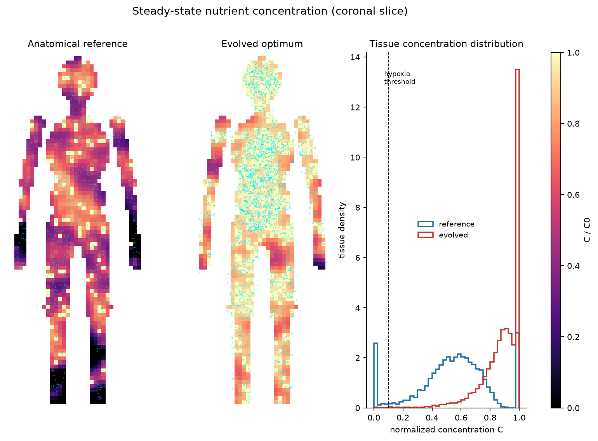

The evolved champion oxygenates 99.8% of tissue (vs 92.5% for the anatomical
reference at the same physics) while spending **exactly the same vessel
volume (0.36 L)** — the evolved network is genuinely more efficient at this
mesoscale delivery task, which it achieves by spending its radius budget on
many fine terminals instead of thick trunks.

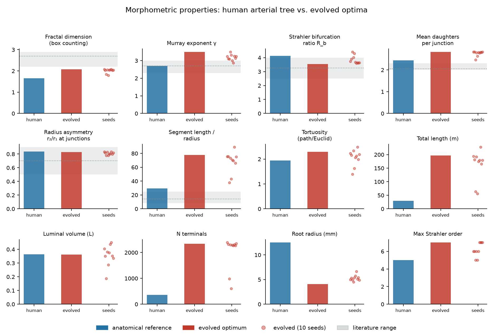
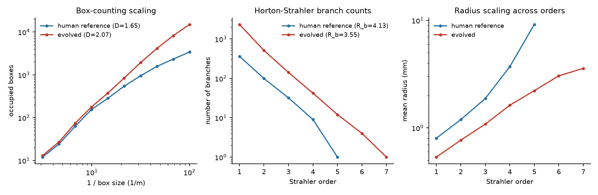

| Property | Human reference | Evolved | Literature |
|---|---|---|---|
| Fractal dimension (box counting) | 1.65 | 2.07 ± 0.10 | 2.2–2.9 (whole network) |
| Murray exponent γ | 2.7 | 3.2 ± 0.2 | 2.3–3.0 |
| Strahler bifurcation ratio | 4.1 | 3.9 ± 0.3 | 2.5–4.0 |
| Radius asymmetry at junctions | 0.84 | 0.81 ± 0.02 | 0.5–0.9 |
| Mean daughters per junction | 2.4 | 2.8 ± 0.1 | 2.0–2.3 |
| Luminal volume | 0.36 L | 0.36 ± 0.07 L | ~0.5 L (arteries) |
| N terminals | 364 | ~2,000 | — |
| Total length | 29 m | 160 ± 50 m | — |
| Root radius | 12.5 mm | 4–5 mm | 12.5 mm (aorta) |

(Full table: `results/comparison_table.md`.)

**What converges.** The *scaling* properties — the ones physics constrains —
match well: bifurcation ratio inside the measured human range, junction
radius asymmetry nearly identical (0.81 vs 0.84), Murray-type radius scaling
with an exponent in the physiological neighborhood, exponential
Horton–Strahler branch-count scaling (straight lines in fig. 4), and total
luminal volume indistinguishable from the reference. Evolution rediscovers
a hierarchical, asymmetric, space-filling bifurcating tree — nobody told the
genome to build one; a brush, a comb, or a fractal pom-pom were all
reachable phenotypes.

**What diverges.** The evolved optimum prefers ~2,000 half-millimetre
terminals over the anatomy's ~360 at this scale: a thinner root (4–5 mm vs
12.5 mm), 5× the total length, and a higher γ (≈3.2–3.5 vs 2.7–3.0,
i.e. thinner trunks relative to daughters). This is the fingerprint of what
the model omits: at resting flows Poiseuille dissipation in >0.5 mm vessels
is cheap, so there is little pressure to maintain thick conduits. Real
aortas are sized for exercise (×5 cardiac output → ×25 dissipation),
pulsatile flow, and turbulence avoidance. Consistently, raising the pumping
weight drags γ back toward Murray's 3 and thickens the tree (fig. 7), and
the human-like sparse architecture becomes optimal exactly when the
perfusion depth δ grows (see sensitivity).

### Diversity of the optima

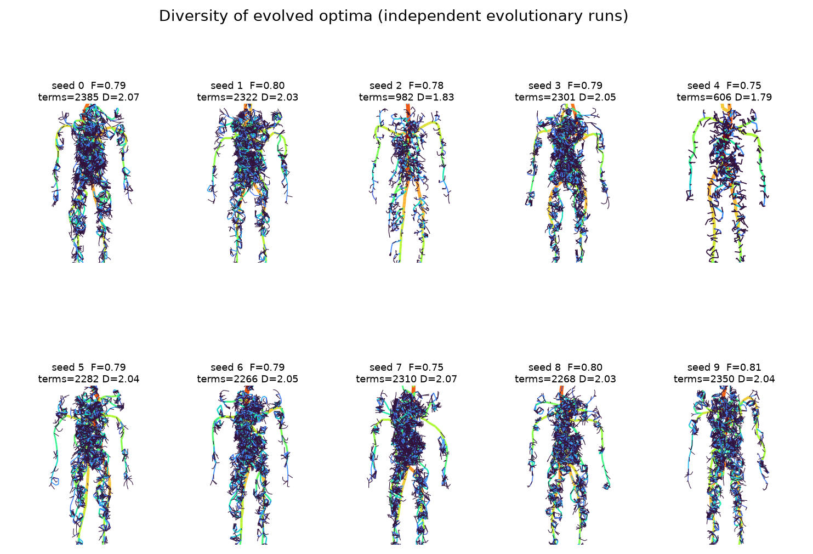
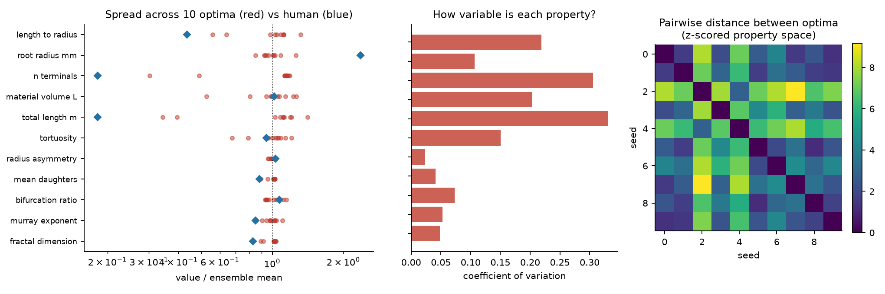

Ten independent evolutionary runs (different GA randomness *and* different
developmental noise) suggest a fitness landscape with **two basins**:

* 8/10 seeds converge on the *dense-fine* strategy — 2,270–2,390 terminals,
  fractal dimension 2.03–2.07, fitness 0.79–0.81;
* 2/10 seeds land in a *sparse* local optimum — 600–980 terminals, fractal
  dimension 1.79–1.83, fitness 0.75–0.78 (the fitness deficit is not
  statistically established at n = 2; the structural gap in terminal count,
  982 vs 2,266 with nothing in between, is what suggests a genuine basin).

Within the dominant basin the optima are strikingly similar where it
matters: coefficients of variation are ~2% for junction asymmetry, ~4–5%
for fractal dimension, Murray exponent and mean daughters — while *size*
properties (terminal count, total length) vary by 30%+. **Scaling laws are
universal across solutions; size is contingent.** The pairwise-distance
heatmap (fig. 6, right) shows seeds 2 and 4 as the outlier pair. This is a
pleasing echo of real vasculature, where scaling exponents are conserved
across individuals and species while absolute network size varies.

### Control experiment: the same evolution in a box

Does the body's shape matter, or are the network properties intrinsic to the
delivery/cost physics? We repeated the full 10-seed ensemble in a
uniform-demand cube of equal tissue volume (40 cm side, 64 L vs the body's
62.9 L), same voxel size, same physics, same evolutionary budget, with the
root at the cube centre (`experiments/run_box.py`). To make geometric
comparisons fair, fractal dimensions here are measured over the same
1–12 cm box-counting window for all networks, and two explicit space-filling
measures are added: the Clark–Evans dispersion of the terminal points
(1 = Poisson, >1 = uniform-like, <1 = clustered) and the mean
tissue-to-vessel distance normalized by the ideal equal-territory radius.

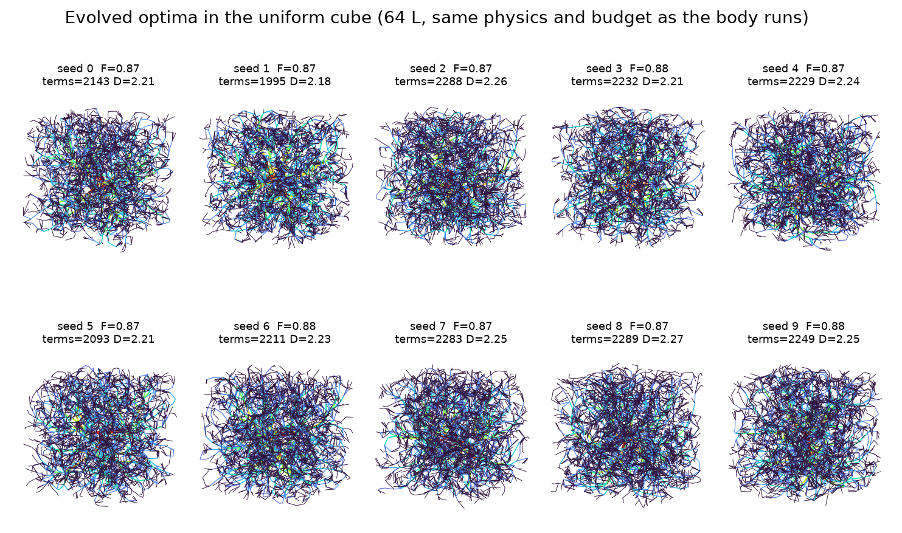
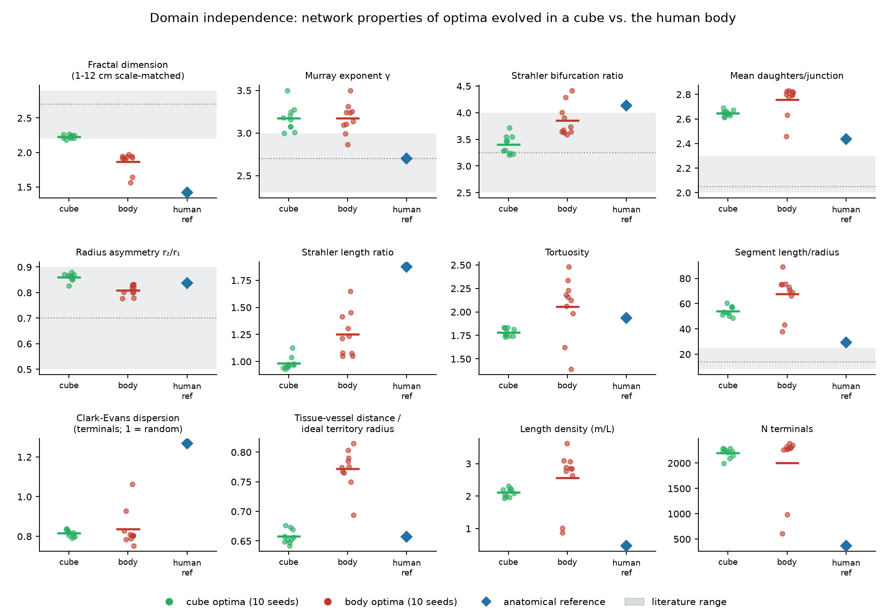
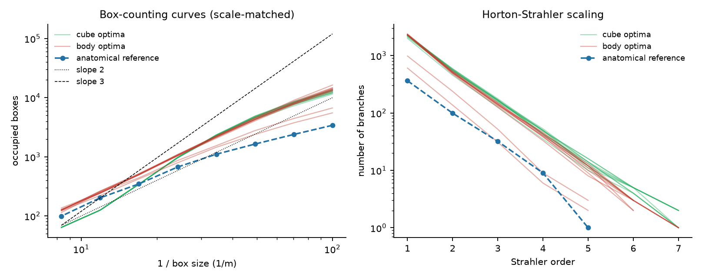

| Property | Cube optima (10) | Body optima (10) | Human ref | Literature |
|---|---|---|---|---|
| Fractal dimension (scale-matched) | 2.23 ± 0.03 | 1.87 ± 0.13 | 1.42 | 2.2–2.9 |
| Murray exponent γ | 3.17 ± 0.14 | 3.17 ± 0.17 | 2.7 | 2.3–3.0 |
| Strahler bifurcation ratio | 3.40 ± 0.16 | 3.85 ± 0.28 | 4.13 | 2.5–4.0 |
| Mean daughters/junction | 2.65 ± 0.02 | 2.76 ± 0.11 | 2.43 | 2.0–2.3 |
| Radius asymmetry r₂/r₁ | 0.86 ± 0.01 | 0.81 ± 0.02 | 0.84 | 0.5–0.9 |
| Tortuosity | 1.78 ± 0.04 | 2.06 ± 0.31 | 1.94 | — |
| Clark–Evans dispersion | 0.82 ± 0.02 | 0.84 ± 0.09 | 1.27 | — |
| Tissue–vessel dist. / ideal radius | 0.66 ± 0.01 | 0.77 ± 0.03 | 0.66 | — |
| Length density (m/L) | 2.11 ± 0.12 | 2.6 ± 0.9 | 0.47 | — |
| N terminals | 2,200 ± 90 | 2,000 ± 600 | 364 | — |

(Full table: `results/box_comparison_table.md`.)

**Radius-scaling economics are domain-independent; branching statistics
mostly are, with small but real domain shifts.** The Murray exponent is
equivalent across domains in the strong sense — the 95% CI bounds any true
cube-body difference below 0.16 (3.17 ± 0.14 vs 3.17 ± 0.17) — and
daughters-per-junction, terminal count and terminal dispersion show no
detectable difference. The Strahler bifurcation ratio (3.40 vs 3.85),
junction asymmetry (0.86 vs 0.81) and Strahler length ratio do differ
significantly (Holm-corrected Mann-Whitney, n = 10 per ensemble; see
`results/significance_tests.md`): the domain leaves a measurable, though
small, fingerprint even on topology. The first-order structure is set by
the economics of delivery; anatomy perturbs it.

**Metric/embedding properties carry the domain's signature.** In the cube
the scale-matched fractal dimension rises to 2.23 ± 0.03 — into the
measured range for real vascular beds — while the same optimization pressed
into a human silhouette yields 1.87 ± 0.13: threading a network through
quasi-one-dimensional limbs dilutes box counts at intermediate scales, and
tortuosity rises (1.78 → 2.06) as vessels navigate the geometry. Comparing
vascular fractal dimensions across organs of different shape without
scale-matching is therefore misleading — part of the measured "fractality"
is the container, not the network.

**The cube also shows what the body's shape does to the fitness
landscape.** All 10 cube runs converge on one tight optimum (fitness
0.8672–0.8762, terminals 1,995–2,289), while the body ensemble produced
2/10 sparse outliers — consistent with body geometry creating a second
basin (how much network to commit to each appendage), though with n = 2
this is suggestive rather than established and could also reflect
incomplete GA convergence in the harder domain.

**Space-filling.** Evolved optima in both domains fill space the same way:
tissue sits at 0.66–0.77 of the ideal territory radius from the nearest
vessel, with terminals mildly *clustered* relative to Poisson (CE ≈ 0.82).
The anatomical reference is more regular (CE = 1.27, lattice-like spacing
from its constant kill radius) yet achieves the same normalized
tissue–vessel distance (0.66) with one-fifth the length density — a
reminder that regular spacing, which real development approximates through
local feedback, is the material-efficient way to fill a volume.

### Sensitivity analysis

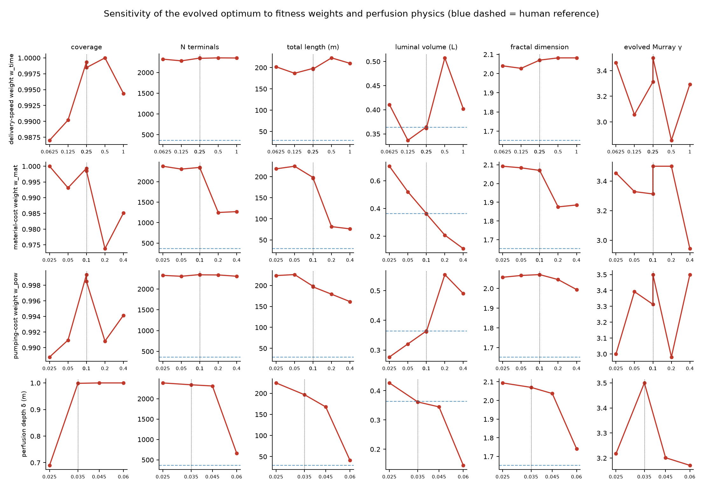

One-at-a-time sweeps (full evolution per condition, 18 conditions) around
the baseline:

* **Coverage is robust** (0.97–1.00 everywhere): delivery dominates the
  optimum regardless of weights — as in biology, the circulation exists to
  perfuse, and costs only sculpt *how*.
* **Material cost w_mat is the main structural lever.** ×16 increase drives
  luminal volume 0.70 → 0.11 L, halves the terminal count, and lowers the
  fractal dimension 2.09 → 1.89: expensive tissue buys a sparser, more
  anatomical tree.
* **Pumping cost w_pow mainly thickens vessels** (volume 0.28 → 0.49 L
  across the sweep) and pulls the radius exponent toward Murray's
  prediction; terminal count barely moves.
* **Perfusion depth δ is the strongest knob of all.** At δ = 2.5 cm full
  coverage becomes physically unreachable (0.69 at best); at δ = 6 cm the
  optimum collapses to 658 terminals, 0.14 L and FD 1.74 — closely
  resembling the sparse anatomical architecture. The structure of the
  optimal tree is set less by the economics than by **how far diffusion can
  reach**, which is why real bodies, whose true Krogh distance is ~100 µm,
  must continue the hierarchy far below this model's floor into billions of
  capillaries.

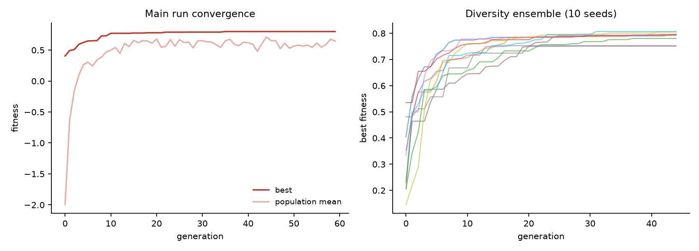

### Which results are statistically significant?

`experiments/run_stats.py` tests the ensemble claims
(`results/significance_tests.md`). In short:

* **Robust (Holm-corrected p < 0.01, |d| ≥ 1.8):** the domain effect on
  fractal dimension (2.23 vs 1.87), normalized tissue–vessel distance,
  bifurcation ratio, length ratio, and junction asymmetry; the Murray
  exponent's domain *equivalence* (|Δ| < 0.16 at 95%); and terminal
  clustering relative to Poisson in both domains (CE < 1, p ≤ 0.004).
* **Suggestive, not established:** the two-basin structure of the body
  landscape (n = 2 sparse seeds); tortuosity, segment length/radius and
  length-density domain differences (raw p ≈ 0.03, do not survive
  correction); nearly all sensitivity-sweep trends, which are n = 1
  evolution per condition — only the luminal-volume response to the
  material weight is formally supported (perfectly monotone over 5
  conditions, exact trend p = 0.017).
* **Not statistical claims at all:** comparisons against the anatomical
  reference (a single hand-built model whose distal statistics are
  partially generated by the same growth engine) and against literature
  ranges (wide bands from heterogeneous organs/species). These are
  model-to-model consistency checks, not hypothesis tests.

## Interpretation

Within this model's horizon the human-like architecture is *not* uniquely
optimal — a denser, finer, thinner-trunked network delivers the same
coverage for the same material. The constraints that make real anatomy
optimal are precisely the ones outside a resting-state, artery-level
diffusion model: exercise-range flows, pulsatility, and the four
orders of magnitude of scale separating the aorta from the capillaries.
Where the model and reality share constraints — space-filling delivery
against material/energy budgets — evolution in silico reproduces the same
structural grammar: hierarchical asymmetric bifurcations, exponential
Strahler scaling, Murray-type radius conservation, and a conserved set of
scaling exponents across independent evolutionary histories.

## Reproducing

```bash
pip install -r requirements.txt
python3 experiments/run_main.py          # ~3 min on 4 cores
python3 experiments/run_diversity.py     # ~15 min, 10 seeds
python3 experiments/run_sensitivity.py   # ~15 min, 18 conditions
python3 experiments/run_box.py           # ~20 min, 10 seeds in the cube
python3 experiments/make_figures.py      # figs 1-8 + comparison table
python3 experiments/make_box_figures.py  # figs 9-11 + box table
```

All experiment outputs (champion trees, metrics, histories) are committed
under `results/`, figures under `figures/`.

## Key constants and sources

* O₂ diffusivity in tissue 2×10⁻⁹ m²/s; Krogh (1919) tissue-cylinder model.
* Whole-body VO₂ 250 mL/min; blood O₂ content 20 mL/dL; cardiac output
  5 L/min; mean arterial pressure 93 mmHg; blood viscosity 3.5 mPa·s.
* Arterial blood volume ~0.5 L (10–13% of 5 L); artery-level pressure drop
  ~25% of total.
* Murray (1926) — the cost-of-blood principle predicting γ = 3; measured
  γ ≈ 2.55–3.0 (Zamir; Sherman 1981).
* Strahler bifurcation ratios 2.5–4.0 from coronary and pulmonary casts
  (Kassab et al. 1993; Huang et al. 1996).
* Vascular fractal dimensions 2.2–2.9 (Lorthois & Cassot 2010 and refs).
* Major-artery radii/topology from standard 1D hemodynamic datasets
  (Westerhof et al.; Olufsen et al.).

## Limitations

* Mesoscale: the tree stops at ~0.5 mm vessels; the microcirculation is
  abstracted into a 3.5 cm effective perfusion depth per terminal.
* Resting hemodynamics only; no pulsatility, no exercise envelope, no
  turbulence constraint on the aorta.
* The reference tree's distal infill uses the same growth engine
  (literature-parameterized), so fine-scale reference statistics are
  model-informed; shaded literature bands in the plots are the
  measurement-grounded comparison.
* Single-objective scalarization; a Pareto-front study would separate the
  trade-off surface from the weight choice.
